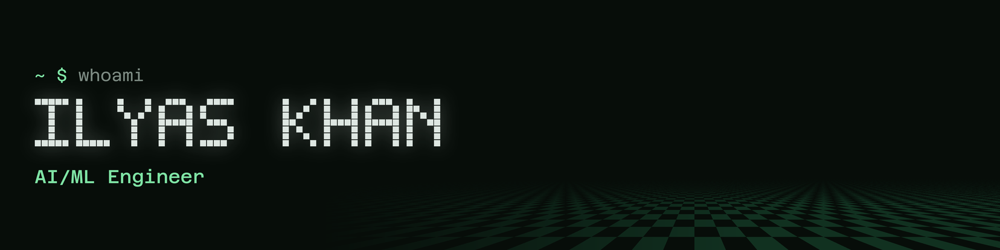

### ~ $ whoami

AI/ML engineer in Karachi. I build and deploy AI systems end to end: from picking the model and designing the pipeline to shipping it as a FastAPI service on real client data.

1+ year in industry. Computer Science student at Dawood University. Open to remote work.

### ~ $ ls projects/

```text
free-kick-analyzer/    video in, one annotated clip per kick out: keypoints, ball box, trajectory
alphastream-omni/      earnings-call audio to BUY / HOLD / SELL, via Whisper + FinBERT + Gemma
exoplanet-predictor/   Kepler data classifier, 92.79% accuracy (NASA Space Apps 2025)
id-card-ocr/           OpenCV + Tesseract, structured text over a FastAPI endpoint
```

[Alpha-stream-Omni](https://github.com/IlyasKhan11/Alpha-stream-Omni) · [Nasa-Space-App-Challenge](https://github.com/IlyasKhan11/Nasa-Space-App-Challenge) · [Nasa-Space-App-Frontend](https://github.com/IlyasKhan11/Nasa-Space-App-Frontend)

The Tezeract projects were built for clients, so their code stays private.

### ~ $ cat stack.py

```python
stack = {
    "languages":  ["python", "c/c++", "javascript", "sql"],
    "llm_genai":  ["langchain", "langgraph", "rag", "whisper", "hugging face"],
    "ml":         ["pytorch", "scikit-learn", "xgboost", "pandas", "numpy"],
    "vision":     ["opencv", "yolov8", "mediapipe", "tesseract"],
    "mlops":      ["mlflow", "dvc", "docker", "aws", "linux"],
    "backend":    ["fastapi", "postgresql", "mongodb", "sqlite"],
}
```

### ~ $ cat values.md

```text
First principles   Reason from the ground up, like a proof.
Think in moves     See the next ten before making one.
Rigor over hype    Measure it before you claim it.
Build to last      Ship systems that hold up in production.
```

### ~ $ contact

[ilyaskhan11.github.io](https://ilyaskhan11.github.io) · [linkedin](https://www.linkedin.com/in/muhammad-ilyas-khan-88920122a/) · [medium](https://medium.com/@ilyas.dev2021) · ilyas.dev2021@gmail.com

```text
~ $ ▌
```
